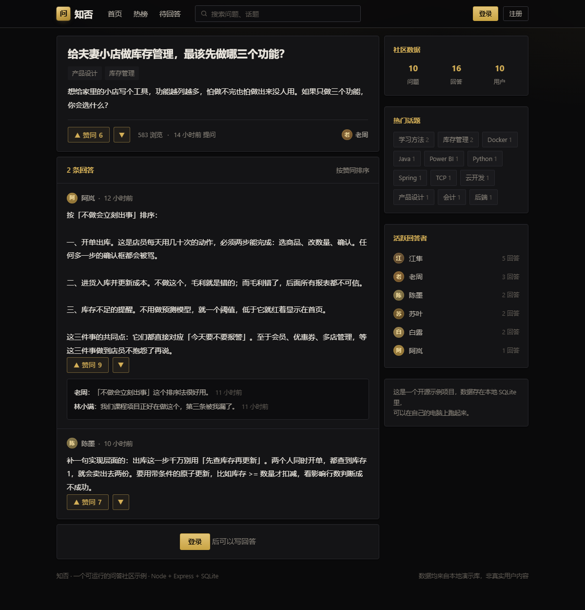

# 知否 · ZhiFou

一个可以自己跑起来的问答社区。提问、回答、投票、评论、话题、热榜，数据存在本地 SQLite 里，
不需要注册任何云服务，`npm start` 就有东西可点。界面是**黑金暗色主题**，无 UI 框架、无构建步骤。




## 为什么做这个

想验证一件事：一个「像知乎」的站点，最小需要多少个概念。

答案是五个——**问题、回答、投票、评论、话题**。围绕这五个做对了，剩下的（关注、收藏、私信、推荐）
都是在它们上面加壳，而不是另起一套。

所以这个仓库刻意做成**单进程、无构建、零原生依赖**：`git clone` 之后两条命令就能跑，
方便别人看代码，也方便自己半年后还看得懂。

## 功能

| 模块 | 说明 |
|---|---|
| 账号 | 注册 / 登录 / 退出，密码用 `scrypt` 加盐哈希，会话存在服务端表里（不信任客户端 Cookie 内容） |
| 提问 | 标题 + 描述 + 最多 5 个话题，话题自动建表关联 |
| 回答 | 一个问题下可多条回答，按赞同数排序 |
| 投票 | 回答可赞同 / 反对，可取消；**不能给自己的回答投票**；问题本身也能投票 |
| 评论 | 挂在回答下，超过 2 条折叠 |
| 话题 | 话题页聚合问题，侧栏显示热门话题及问题数 |
| 列表 | 最新 / 热榜 / 待回答三种排序，支持关键词搜索 |
| 个人主页 | 提问数、回答数、获得的赞同，以及最近的提问与回答 |

## 快速开始

需要 **Node.js 22.5+**（用到内置的 `node:sqlite`，不需要编译 `better-sqlite3`）。

```bash
git clone https://github.com/ZhangJiajie20061102/zhifou.git
cd zhifou
npm install        # 只装 Express 一个依赖
npm run seed       # 写入演示数据：10 个用户 / 10 个问题 / 16 条回答
npm start          # http://localhost:3000
```

想清空重来：`npm run reset`

### 演示账号

| 邮箱 | 密码 | 说明 |
|---|---|---|
| `chenmo@example.com` | `123456` | 前端，问过 2 个问题 |
| `laozhou@example.com` | `123456` | 零售数据分析，赞同最多 |
| `linxiaoman@example.com` | `123456` | 学生 |

所有演示账号密码都是 `123456`，也可以直接用昵称登录（例如 `陈墨`）。

## 目录结构

```
zhifou/
├── server.js            # Express 应用：路由、校验、热榜排序，约 500 行
├── db.js                # 建表 DDL、索引、事务封装
├── auth.js              # 密码哈希、会话、登录中间件
├── seed.js              # 演示数据（同时也是一份「怎么用」的示例）
├── public/
│   ├── index.html       # 单页外壳
│   ├── style.css        # 全部样式，无预处理器
│   └── app.js           # 哈希路由 + 渲染 + 交互，无框架
├── Dockerfile
└── LICENSE
```

## 数据模型

```
users ──┬─< questions ──< question_tags >── tags
        │       │
        │       └─< answers ──< comments
        │              │
        └──────────────┴─< votes (user_id, target_type, target_id, value)
```

`votes` 用 `(user_id, target_type, target_id)` 做联合主键，所以「同一人对同一对象只能有一票」是
**数据库层面**保证的，不靠应用层判断。取消投票就是把行删掉。

## 接口

| 方法 | 路径 | 说明 |
|---|---|---|
| POST | `/api/register` | 注册（昵称、邮箱、密码） |
| POST | `/api/login` | 登录，支持邮箱或昵称 |
| POST | `/api/logout` | 退出，删除会话行 |
| GET | `/api/me` | 当前登录用户 |
| GET | `/api/questions` | 列表：`?sort=new\|hot\|unanswered&q=&tag=&author=&limit=&offset=` |
| POST | `/api/questions` | 提问（需登录） |
| GET | `/api/questions/:id` | 详情，含回答、评论、我的投票状态；每次访问浏览量 +1 |
| POST | `/api/questions/:id/answers` | 写回答（需登录） |
| POST | `/api/answers/:id/comments` | 发评论（需登录） |
| POST | `/api/vote` | 投票：`{targetType, targetId, value}`，`value=0` 表示取消 |
| GET | `/api/users/:id` | 个人主页数据 |
| GET | `/api/overview` | 侧栏数据：社区总数、热门话题、活跃回答者 |

出错统一返回 `{ "error": "中文说明" }` 和对应状态码（400 参数错、401 未登录、404 不存在、409 重复）。

## 几个实现上的选择

**1. 热榜不是按票数排。**
纯按票数排序，老问题会永远压在顶上。这里用了一条衰减公式：

```js
score = (票数×3 + 回答数×5 + 浏览量×0.2 + 评论数×1.5 + 1) / (存在小时数 + 2) ^ 1.5
```

回答数和评论数权重高于浏览，是因为「有人愿意回答」比「有人点进来」更能说明问题有价值。
演示数据里可以看到：6 票的新问题能排在 7 票的两天前问题前面。

**2. 前端不做 Markdown，也不吃 HTML。**
用户输入一律存原文，渲染时 `esc()` 转义后放进模板，换行靠 CSS 的 `white-space: pre-wrap`。
牺牲了加粗、代码块，换来的是「不可能有存储型 XSS」——这个取舍对示例项目更划算。
真要加 Markdown，正确做法是服务端渲染 + 白名单过滤，而不是直接 `innerHTML`。

**3. 用 `node:sqlite` 而不是 `better-sqlite3`。**
后者更快，但要装编译工具链，Windows 上经常卡在 `node-gyp`。
Node 22 起内置的 `node:sqlite` 是同一个 SQLite 引擎的同步封装，性能对这个小站点完全够，
换来的是 `npm install` 只装一个纯 JS 依赖——别人 clone 下来不会因为环境问题劝退。

**4. 会话表而不是 JWT。**
JWT 好用，但「退出登录」在 JWT 里是个难题（要么等过期，要么再维护一张黑名单表）。
既然已经有数据库，直接把 session 存表、退出时删行，逻辑最短。

## 部署

仓库带 `Dockerfile`，任何支持容器的平台都能跑，例如 Render：

1. New → Web Service，选这个仓库，Runtime 选 **Docker**
2. 免费实例会休眠，首次访问要等十几秒冷启动
3. 容器内数据写在 `data.db`，**不挂持久盘的话重启即丢**——演示够用，真要用得挂卷

本地验证镜像：

```bash
docker build -t zhifou .
docker run -p 3000:3000 zhifou
```

## 已知限制

- 没有分页 UI：接口支持 `limit/offset`，前端一次取 20 条
- 没有编辑 / 删除：写错了只能重发（真要做需要回答的编辑历史）
- 没有富文本、图片、@提醒、关注与通知
- 热榜在内存里排序，问题量上万时应改成 SQL 里算分 + 建索引
- 搜索是 `LIKE '%关键词%'`，没有分词，中文短句够用，长文本会慢

## License

MIT
